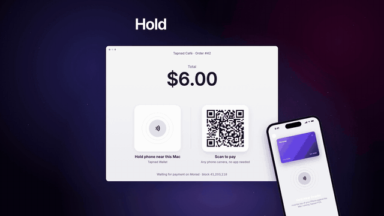

<div align="center">

# Tapnad

**Tap-to-pay for the real world, settled on Monad.**

An Apple-Wallet-style iPhone wallet taps a Mac point of sale to pay in MON on Monad testnet.<br>
Approved the moment the block is proposed. Final in under a second.

[](https://testnet.monadexplorer.com/address/0xF825f70E27b7f65bB44475FB4530b7c09245F128)


[](https://tapnad.vercel.app)

<a href="https://github.com/drewmanley16/monad/releases/tag/launch-video"></a>

</div>

## Launch video

https://github.com/user-attachments/assets/4bed40dc-1c35-4848-ae43-a1920a88f044

<sub>Full-resolution 16:9 and 4:5 cuts are on the [launch-video release](https://github.com/drewmanley16/monad/releases/tag/launch-video).</sub>

---

## How it works

```
 iPhone wallet                      Mac register                         Monad testnet
 ─────────────                      ────────────                         ─────────────
 hold near the Mac  ── BLE / Bonjour ──▶  advertises the active charge
 review · Face ID
 sign on-device (secp256k1) ─────────────────────────────────────────▶  MonadPay.pay(merchant, invoiceId, memo)
                                    "Approved" on Proposed  ◀── monadLogs commit-state stream
                                    Voted → Finalized, live
```

1. **Ring it up.** The POS builds the cart and shows the charge with a contactless tile and a QR code.
2. **Tap.** The register advertises the charge over Bluetooth LE. A real iPhone only triggers when it is held against the Mac (by RSSI). The iOS Simulator finds it over Bonjour.
3. **Pay.** The wallet shows merchant, items and total, confirms with Face ID, and signs the transaction on the device. No wallet SDK, and the key never leaves the Keychain.
4. **Settle.** The register flips to **Approved** as soon as the payment is *Proposed* (~300 ms blocks), then walks through *Voted → Finalized* live from Monad's `monadLogs` commit-state stream.

## Features

| | |
|---|---|
| **Contactless tap** | BLE proximity on real devices, Bonjour for the simulator |
| **No app? Scan to pay** | The register's QR opens [web checkout](https://tapnad.vercel.app), which pays from any phone's browser |
| **Live settlement** | Proposed → Voted → Finalized, streamed from the chain and linked to the explorer |
| **Tips, splits & refunds** | Tip presets, split the bill, refund an order from the register |
| **Loyalty** | Stamps keyed to the payer's wallet, with no sign-up |
| **Kitchen & insights** | Kitchen ticket view, an orders and customers log, and Swift Charts dashboards in both apps |
| **Test money** | A built-in faucet funds new wallets on testnet |

## Project layout

| Part | Path | Notes |
|---|---|---|
| Wallet (iOS 18+) | [`apps/Wallet`](apps/Wallet) | SwiftUI, on-device secp256k1 signing, Face ID, Keychain |
| POS (macOS 15+) | [`apps/POS`](apps/POS) | Catalog + cart, charge screen, kitchen, Activity dashboard, live blocks |
| Shared | [`apps/Shared`](apps/Shared) | Monad RPC + WebSocket stream, MonadPay ABI, payment request, design system |
| Contract | [`contracts/`](contracts) | `MonadPay.pay(merchant, invoiceId, memo)` forwards MON and emits `Paid` |
| Web | [`web/`](web) | Next.js browser checkout, sign-up and faucet ([tapnad.vercel.app](https://tapnad.vercel.app)) |

**MonadPay** on Monad testnet (chain 10143): [`0xF825f70E27b7f65bB44475FB4530b7c09245F128`](https://testnet.monadexplorer.com/address/0xF825f70E27b7f65bB44475FB4530b7c09245F128)

## Run it

```bash
./scripts/go.sh   # waits for deployer funds → deploys → builds & launches both apps → funds the sim wallet
```

Manual: `cd apps && xcodegen generate && open Tapnad.xcodeproj` (schemes: **Wallet**, **POS**).

Requires Xcode 16+, [Foundry](https://getfoundry.sh) for the contract, and testnet MON from the [Monad faucet](https://faucet.monad.xyz).
